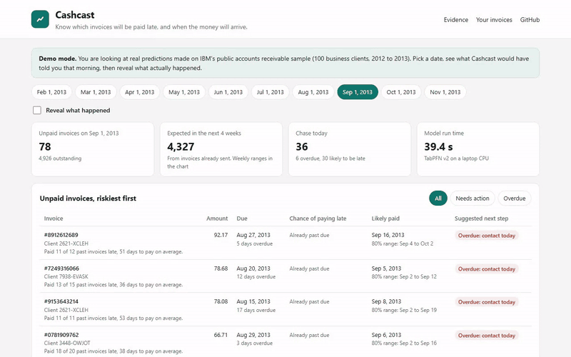

# Cashcast

Know which invoices will be paid late, and when the money will arrive, before you chase anyone.

Cashcast is a small receivables tool for freelancers, small agencies and the bookkeepers who manage invoices for them. You give it your invoice history as a CSV. [TabPFN](https://github.com/PriorLabs/TabPFN), an open tabular foundation model, runs on your own laptop and tells you, for every unpaid invoice:

- the chance it will be paid late,
- a likely payment date with an 80% range, updated for how long the invoice has already been open,
- a suggested next step (contact today, send a reminder now, remind on the due date, or nothing),
- how much cash to expect in each of the next eight weeks.

Your client list and amounts never leave your computer.

**Live demo:** https://starknightt.github.io/cashcast/ (demo mode, no install)



## Demo mode

The live page replays IBM's public accounts receivable sample (2,466 invoices from 100 business clients, 2012 to 2013). Pick a date such as Sep 1, 2013 and you see what Cashcast would have said that morning, using only invoices paid before that date. Tick **Reveal what happened** to see the real payment dates next to the predictions.

The demo numbers were produced by the same code in this repository (`python -m cashcast.demo`); nothing on the page is typed by hand.

## Run it on your own invoices

Python 3.10 or newer. A CPU is enough.

```bash
git clone https://github.com/StarKnightt/cashcast
cd cashcast
pip install -r requirements.txt
python -m cashcast.serve        # opens http://localhost:8765
```

The first run downloads the TabPFN v2 weights from Hugging Face (no account needed). In local mode the page gets a file picker, and a button that scores `web/sample.csv` as of Sep 1, 2013. The file goes from your browser to the Python process on `127.0.0.1` and nowhere else.

CSV format, one row per invoice:

| column | example | notes |
|---|---|---|
| `client` | `acme` | any text id |
| `invoice_id` | `1042` | any text id |
| `issued` | `2026-09-01` | date sent |
| `due` | `2026-10-01` | due date |
| `amount` | `1200` | number |
| `paid` | `2026-10-04` | leave empty if still open |

Optional columns `region` and `channel` are used as extra features when present. TabPFN needs at least 20 paid invoices; on a CPU it uses the 1,000 most recent paid ones.

## How it works

1. **Features from the day the invoice was sent.** For each invoice, `cashcast/features.py` uses only invoices that were already paid on its issue date: how many, how often late, average days to pay, the last payment, how many of the client's invoices were still open, and the amount compared with the client's usual. No information from the future leaks in.
2. **TabPFN learns in one pass.** `cashcast/model.py` fits a TabPFN v2 classifier (late or not) and regressor (days to pay) on recent paid invoices. TabPFN is pre-trained on synthetic tables, so "fitting" is a single forward pass with no training loop or tuning.
3. **A distribution, not one number.** The regressor returns 49 quantiles of days to pay for each invoice. `cashcast/forecast.py` conditions that distribution on the invoice's current age (an invoice unpaid after 25 days is a different bet from a new one), reads off the late-payment chance and the 80% range, and simulates 2,000 payment schedules to get a weekly cash range.
4. **Plain rules for the next step.** Overdue: contact today. Late chance of 50% or more: send a reminder now. 30% or more: remind on the due date. The history line next to each invoice is computed from the data, not generated text.

## Results

All numbers come from `results/backtest.json` and `results/replay.json`.

**Backtest.** For each month from January to October 2013, every model was trained only on invoices paid before the month started and then predicted the invoices sent that month (1,075 predictions).

| Model | AUC | Brier | Chase recall | Pay day error | 80% range hit |
|---|---|---|---|---|---|
| TabPFN v2 | 0.882 | 0.127 | 51.0% | 5.92 days | 79.1% |
| Logistic / linear regression | 0.890 | 0.122 | 50.4% | 5.81 days | 79.3% |
| Client history average | 0.870 | 0.135 | 50.7% | 6.54 days | n/a |
| Gradient-boosted trees | 0.864 | 0.154 | 49.9% | 6.23 days | 57.5% |
| Base rate | 0.5 | 0.218 | 18.4% | 10.11 days | n/a |

"Chase recall" is the share of late invoices caught by chasing only the riskiest 20% each month.

On this dataset a plain linear model is as accurate as TabPFN. What TabPFN adds is a separate distribution for each invoice. Splitting clients into thirds by how much their past payment times varied (`tools/adaptivity.py`): for steady clients TabPFN's 80% range is 16.0 days wide (80.5% hit) against the linear model's fixed 18.4 days (83.8% hit); for erratic clients it widens to 19.9 days (73.3% hit) against 18.4 days (69.7% hit). Both under-cover the erratic third.

**Replay check** of exactly what the demo shows (10 dates, 905 unpaid-invoice rows): 78% of the 296 "send a reminder now" flags were in fact paid late (the late share among not-yet-due invoices was 43%); the payment date fell inside the 80% range 77.1% of the time with a typical miss of 5.78 days. Weekly cash landed inside its 80% range in only 67.5% of 80 weeks, because the simulation treats invoices as independent. About 40 seconds per date on a laptop CPU (TabPFN v2, 1,000 training rows, classifier and regressor).

## Limits

- The demo data is one public sample of business-to-business invoices, all on 30-day terms, with no currency. Your ledger will behave differently; check the backtest on your own history before trusting it.
- The dataset only contains invoices that were eventually paid, so it says nothing about invoices that are never paid.
- The weekly cash range is too narrow (see above).
- Cashcast suggests whom to contact; it does not send anything.

## Reproduce

```bash
python -m cashcast.backtest     # about 7 minutes on a CPU, writes results/backtest.json
python -m tools.adaptivity      # range width and hit rate by client type
python -m cashcast.demo         # about 7 minutes, writes web/data/replay.json
python -m tools.make_sample     # writes web/sample.csv
```

The IBM CSV is downloaded on first use from a public mirror into `data/raw/` and is not stored in this repository.

## Credits and licenses

- Cashcast: MIT, see [LICENSE](LICENSE).
- Built with PriorLabs-TabPFN. Uses the `tabpfn` package and the TabPFN v2 weights, released under the [Prior Labs License 1.1](https://github.com/PriorLabs/TabPFN/blob/main/LICENSE) (Apache 2.0 with an attribution clause).
- Demo data: IBM Watson Analytics sample dataset "Accounts Receivable" (also known as "Finance Factoring: IBM Late Payment Histories").
- scikit-learn and pandas for the baselines and data handling.

Started on October 12, 2026 (19:00 UTC) for the DEV Hacktoberfest Open-Source AI Challenge, Week 2: Side Hustle.
